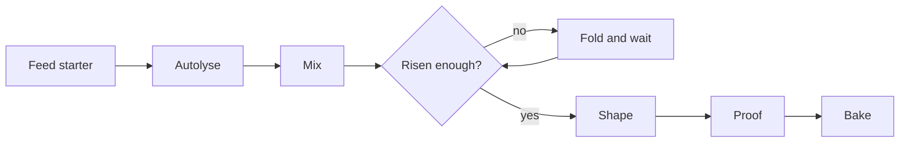

###### A notebook that does the arithmetic

# The sourdough notebook

Bread is four ingredients and a clock. This page is ordinary Markdown with small
programs in it: move a slider and the weights, the timetable, the rise curve and
even the crumb follow. Nothing here is saved; play freely.

> The best loaf is the one you plan backwards from dinner.

###### Step one

## The dough

Bakers write recipes as percentages of the flour, so one formula scales to any
batch. Choose the batch and the formula, and the scale weighs it out.

```bib
let crumbIdx = [0, 1, 2, 3, 4, 5, 6, 7, 8, 9, 10, 11, 12, 13, 14, 15, 16, 17, 18, 19, 20, 21, 22, 23, 24, 25, 26, 27, 28, 29, 30, 31, 32, 33]
let half = [0, 1, 2, 3, 4, 5, 6, 7, 8, 9, 10, 11, 12, 13, 14, 15, 16, 17, 18, 19, 20, 21, 22, 23, 24]

let loaves = 0
let size = ""
let hyd = 0
let starter = 0
let ww = 0
row {
  card("Batch") {
    loaves = slider("Loaves", 1, 4, value: 2, step: 1)
    size = choice("Each loaf", ["750 g", "900 g", "1.2 kg"], value: "900 g")
  }
  card("Formula") {
    hyd = slider("Hydration %", 60, 90, value: 75, step: 1)
    starter = slider("Starter %", 5, 30, value: 20, step: 1)
    ww = slider("Whole wheat %", 0, 50, value: 20, step: 5)
  }
}

let grams = size == "750 g" ? 750 : size == "900 g" ? 900 : 1200
let dough = loaves * grams
let salt = 2
let flour = dough / (100 + hyd + starter + salt) * 100
let water = flour * hyd / 100

grid(columns: 5) {
  stat("Bread flour", round(flour * (100 - ww) / 100), unit: "g")
  stat("Whole wheat", round(flour * ww / 100), unit: "g")
  stat("Water", round(water), unit: "g", tone: hyd >= 82 ? warning : neutral)
  stat("Starter", round(flour * starter / 100), unit: "g")
  stat("Salt", round(flour * salt / 100, 1), unit: "g")
}
```

The same formula as a picture, drawn from bib's primitives: each bar is a `box` with a
`layer` that fills it to the percentage.

```bib
fn bar(label, pct, top, tone: accent) {
  box(dir: "row", gap: 12) {
    box(width: 120) { text(label, size: sm, color: "muted") }
    box(width: fill, padding: [4, 0, 0, 0]) {
      box(width: fill, height: 12, radius: 6, background: fade(tone, 0.14)) {
        layer { rect(0, 0, w * (pct / top), h, fill: tone, radius: 6) }
      }
    }
    box(width: 64) { text("{round(pct, 1)}%", size: sm, face: mono, weight: bold, color: tone) }
  }
}

box(gap: 10, padding: 18, radius: 12, border: 1, background: "raised") {
  text("Baker's percentages", size: sm, face: mono, caps: true, color: accent)
  bar("Flour", 100, 100)
  bar("Water", hyd, 100, tone: hyd >= 82 ? warning : accent)
  bar("Starter", starter, 100, tone: success)
  bar("Whole wheat", ww, 100, tone: "#B8763A")
  bar("Salt", salt, 100, tone: muted)
  divider()
  box(dir: "row", gap: 8, wrap: true) {
    badge(hyd < 68 ? "stiff, easy to shape" : hyd < 80 ? "a balanced dough" : "wet: wet hands, gentle folds",
      tone: hyd < 68 ? neutral : hyd < 80 ? success : warning)
    if ww >= 30 { badge("thirsty flour: add 2–3% water", tone: accent) }
    if starter >= 25 { badge("fast and sour", tone: warning) }
  }
}
```

###### Step two

## The day

Pick when you mix and how warm your kitchen is. Warm dough ferments faster; a night
in the fridge slows everything down and adds flavour.

```bib
let startH = 0
let cold = false
let temp = 0
let target = 0
row {
  card("Clock") {
    startH = slider("Mix at (hour)", 6, 22, value: 9, step: 0.5)
    cold = toggle("Proof overnight in the fridge", value: true)
  }
  card("Kitchen") {
    temp = slider("Dough temperature °C", 19, 28, value: 24, step: 0.5)
    target = slider("Target rise %", 30, 100, value: 60, step: 5)
  }
}

let clock = m => {
  let mins = round(m) % 1440
  let hh = floor(mins / 60)
  let mm = mins % 60
  let day = m >= 1440 ? " (day 2)" : ""
  return (hh < 10 ? "0" : "") + str(hh) + ":" + (mm < 10 ? "0" : "") + str(mm) + day
}
let span = m => str(floor(m / 60)) + " h " + (round(m % 60) < 10 ? "0" : "") + str(round(m % 60)) + " min"

// Rule of thumb: about 5 hours at 24 °C with 20% starter, faster when warmer or with more starter.
let bulk = max(150, (5 + (24 - temp) * 0.55 + (20 - starter) * 0.06) * 60 * (0.6 + target / 150))
let start = startH * 60
let mixIn = start + 45
let shape = mixIn + bulk
let proof = cold ? 12 * 60 : max(60, 150 - (temp - 24) * 15)
let bake = shape + 30 + proof
let slice = bake + 45 + 120

grid(columns: 4) {
  stat("Bulk", span(bulk), tone: accent)
  stat("Proof", span(proof))
  stat("Hands on", "about 40 min")
  stat("First slice", clock(slice), tone: slice >= 1440 ? warning : success)
}

steps {
  step(1, "Autolyse", status: clock(start), tone: success, who: "Flour and water only", phase: "Day one") {
    text("Mix to a shaggy mass and leave it covered for 45 minutes.")
  }
  step(2, "Add starter and salt", status: clock(mixIn), tone: success, who: "Pinch and fold, 5 min", phase: "Day one")
  step(3, "Bulk with four sets of folds", status: clock(mixIn + 30) + " → " + clock(shape), tone: accent, who: span(bulk), phase: "Day one") {
    chips([clock(mixIn + 30), clock(mixIn + 60), clock(mixIn + 90), clock(mixIn + 120)])
    text("A set of folds: wet hand, lift each side and fold it over, four turns of the bowl.", size: sm, color: "muted")
  }
  step(4, "Pre-shape, rest, shape", status: clock(shape), tone: warning, who: "Bench rest 30 min", phase: "Day one")
  step(5, cold ? "Into the fridge" : "Proof on the counter", status: clock(shape + 30), tone: cold ? accent : warning,
       who: span(proof), phase: cold ? "Overnight" : "Day one")
  step(6, "Preheat the pot", status: clock(bake - 60), tone: danger, who: "250 °C, one hour", phase: bake >= 1440 ? "Day two" : "Day one")
  step(7, "Bake", status: clock(bake), tone: danger, who: "20 min lid on, 25 min lid off", phase: bake >= 1440 ? "Day two" : "Day one")
  step(8, "Cool, then slice", status: clock(slice), tone: success, who: "Two hours. Really.", phase: bake >= 1440 ? "Day two" : "Day one")
}
```

The shape of the day, as a diagram:



###### Step three

## The rise

The dough grows slowly, then quickly, then levels off. The curve is drawn line by line
in a `layer`; the dashed green line is your target, the dot is where you are.

```bib
let k = bulk / 60 * 1.08
let rise = t => 130 * t * t / (t * t + k * k)
let now = slider("Hours since mixing", 0, 12, value: 3, step: 0.25)
let r = rise(now)

box(width: fill, height: 220, radius: 12, border: 1, background: "raised") {
  layer {
    for g in [0, 35, 70, 105, 140] {
      line(0, 10 + (h - 20) * (1 - g / 140), w, 10 + (h - 20) * (1 - g / 140), color: fade(muted, 0.15))
    }
    for i in [0, 2, 4, 6, 8, 10, 12, 14, 16, 18, 20, 22, 24, 26, 28, 30, 32, 34, 36, 38] {
      rect(w * (i / 40), 10 + (h - 20) * (1 - target / 140), w / 80, 2, fill: fade(success, 0.7))
    }
    line(w * (bulk / 60 / 12), 0, w * (bulk / 60 / 12), h, color: fade(accent, 0.35), width: 1)
    for i in half where i < 24 {
      let a = rise(i / 2)
      let b = rise((i + 1) / 2)
      line(w * (i / 24), 10 + (h - 20) * (1 - a / 140), w * ((i + 1) / 24), 10 + (h - 20) * (1 - b / 140),
           color: accent, width: 2.5)
    }
    circle(w * (now / 12), 10 + (h - 20) * (1 - r / 140), 9, fill: fade(accent, 0.25))
    circle(w * (now / 12), 10 + (h - 20) * (1 - r / 140), 5, fill: r > 100 ? danger : r >= target ? success : accent)
  }
}

row(fit: true) {
  text("Risen about {round(r)}%  ·  ", weight: bold)
  if r > 100 { badge("over-proofed: shape it now, bake it soon", tone: danger) }
  else if r >= target { badge("ready to shape", tone: success) }
  else { badge("{round(target - r)}% to go", tone: accent) }
}
```

###### Step four

## The crumb

A guess at the slice, drawn from circles: a crust, a crumb, and holes whose size
follows the hydration and how far the bulk went. Wetter dough and a full rise open
it up; too little rise keeps it tight, too much tears it.

```bib
let open = max(0, min(1, (hyd - 60) / 30))
let ferment = r < target * 0.6 ? 0.4 : r > 110 ? 0.7 : 1

fn crumb(title, o) {
  box(width: fill, gap: 8) {
    box(width: fill, height: 190, radius: 12, background: "raised") {
      layer {
        circle(w * 0.5, 100, 82, fill: "#8A5326")
        circle(w * 0.5, 100, 74, fill: "#F1E2C4")
        for i in crumbIdx {
          let dx = ((i * 37) % 11 - 5) * 10
          let dy = ((i * 53) % 9 - 4) * 12
          let s = (((i * 7) % 5) + 1) * (0.7 + o * 1.8)
          circle(w * 0.5 + dx, 100 + dy, s, fill: "#D4B98A")
        }
        rect(0, 168, w, 30, fill: "raised")
        line(w * 0.5 - 80, 168, w * 0.5 + 80, 168, color: "#8A5326", width: 6)
      }
    }
    text(title, size: sm, face: mono, caps: true, color: "muted")
  }
}

row {
  crumb("A 65% loaf", 0.17)
  crumb("Yours: {hyd}%, risen {round(r)}%", open * ferment)
  crumb("A 90% loaf", 1)
}
```

###### When the bread argues back

## Troubleshooting

Tick what you saw. The causes are matched to your formula above.

```bib
let seen = list("What went wrong?", selectable: true) {
  item("dense", "Dense and gummy", subtitle: "Heavy, tight, damp in the middle")
  item("flat", "Spread flat in the oven", subtitle: "No height, pale ear")
  item("sour", "Too sour", subtitle: "Sharp, vinegary")
  item("holes", "One huge tunnel", subtitle: "A cave under the crust")
  item("pale", "Pale crust", subtitle: "Soft, no blisters")
}

if seen.selected.length == 0 {
  text("Nothing ticked: a good loaf, then.", color: "muted")
}

grid(columns: 2) {
  if seen.selected.includes("dense") {
    card("Dense and gummy", badge: "under-fermented", badgeTone: warning,
         footer: "Your bulk at {temp} °C is **{span(bulk)}**; try 45 minutes more.") {
      text("The yeast had too little time. Let the bulk go until the dough is domed, jiggly and about {target}% bigger.")
    }
  }
  if seen.selected.includes("flat") {
    card("Spread flat", badge: hyd >= 80 ? "too wet for now" : "over-proofed", badgeTone: danger) {
      text(hyd >= 80 ? "At {hyd}% the dough needs strength you build with practice. Drop to 72% for a few bakes." : "Shape tighter, and keep the proof in the fridge.")
    }
  }
  if seen.selected.includes("sour") {
    card("Too sour", badge: "long and cold", badgeTone: accent) {
      text("Use less starter (now {starter}%) or a shorter cold proof. Younger starter tastes milder.")
    }
  }
  if seen.selected.includes("holes") {
    card("A tunnel", badge: "shaping", badgeTone: accent) {
      text("Air was trapped while shaping. Pre-shape firmly, and degas the surface gently before the final shape.")
    }
  }
  if seen.selected.includes("pale") {
    card("Pale crust", badge: "heat", badgeTone: danger) {
      text("Preheat the pot a full hour, and bake 5–10 minutes longer with the lid off.")
    }
  }
}
```

## The pantry

```bib
let need = it => it.kind == "flour" ? (it.name == "Whole wheat" ? flour * ww / 100 : it.name == "Bread flour" ? flour * (100 - ww) / 100 : it.need) : it.name == "Sea salt" ? flour * salt / 100 : it.need
let short = data.pantry.filter(p => p.have < need(p))

table(["Item", "In the jar", "This bake", "State"],
  data.pantry.map(p => [p.name, "{p.have} g", "{round(need(p))} g",
    p.have < need(p) ? {badge: "buy", tone: danger} : p.have < need(p) * 2 ? {badge: "low", tone: warning} : {badge: "fine", tone: success}]),
  widths: [3, 2, 2, 1])

let bought = []
let note = ""
row {
  card("Shopping", subtitle: short.length == 0 ? "Nothing to buy" : "{short.length} to buy") {
    bought = checklist("Bought", short.map(p => p.name))
    progress("In the bag", bought.length, max: max(1, short.length))
  }
  card("Bake log") {
    note = input("Notes for next time", multiline: true, placeholder: "Crumb, crust, what I would change")
    kv([
      {label: "Formula", value: "{hyd}% water · {starter}% starter · {ww}% whole wheat"},
      {label: "Dough", value: "{dough} g, {loaves} × {size}"},
      {label: "Mixed", value: clock(start)},
    ])
    row(fit: true) {
      if button("Text me the timetable", style: primary).clicked {
        send("Mix {clock(start)}, folds from {clock(mixIn + 30)}, shape {clock(shape)}, bake {clock(bake)}.")
      }
      if button("Save the notes", style: ghost, disabled: note.length == 0).clicked {
        send("Bake notes ({hyd}%): {note}")
      }
    }
  }
}
```

---

## Plain Markdown, for the record

The rest of the page is ordinary Markdown, which reads (and edits) as it always has.

| Hydration | Feels like       | Good for                 |
| --------- | ---------------- | ------------------------ |
| 60–68%    | Play dough       | Bagels, sandwich loaves  |
| 70–78%    | Soft and springy | A first country loaf     |
| 80–90%    | Batter that holds | Ciabatta, an open crumb |

1. Feed the starter the night before; use it when it has doubled.
2. Weigh everything, water included.
3. Write down the room temperature. It explains most surprises.

```text
starter feed  1 : 5 : 5   (starter : flour : water)
float test    a spoonful floats → ready
```
